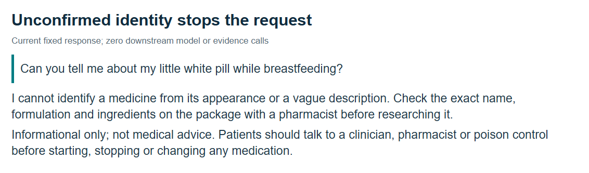
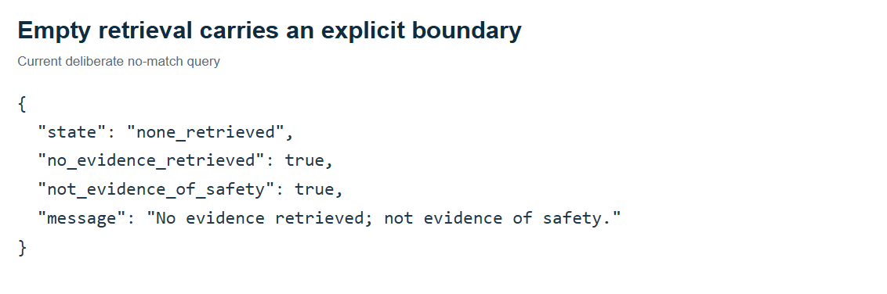
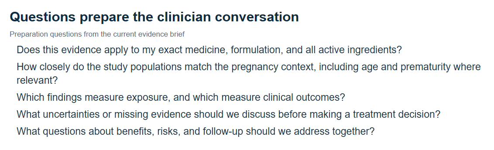
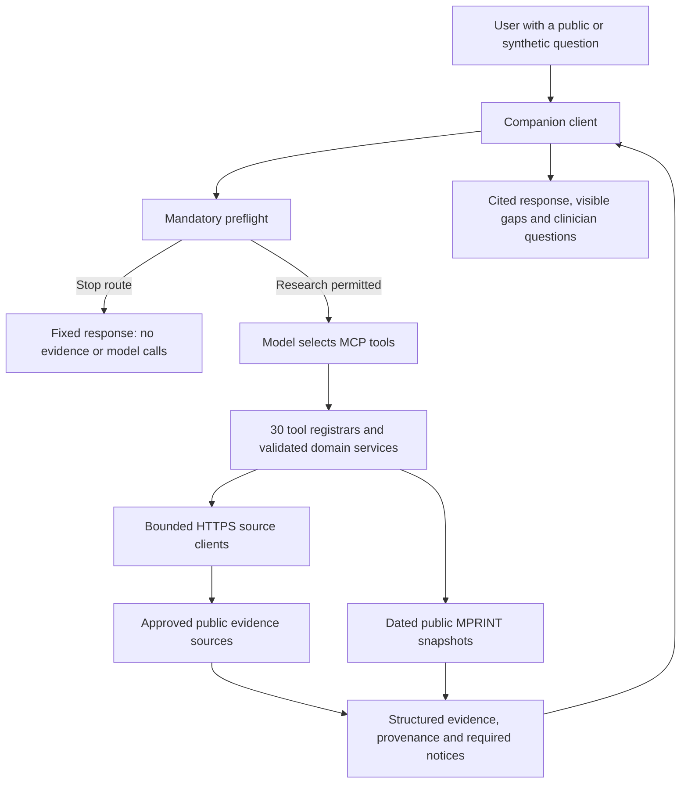

# Parent-child Pharmacology MCP

**GSA MCP & SI Agent Government Hackathon · Track: Dataset Access Server**

**THIS MCP HAS BEEN MADE FOR THE PURPOSE OF THE GSA HACKATHON AS A PROTOTYPE AND IS NOT AN NIH OFFICIAL MCP TOOL. NO PRODUCTION READINESS CLAIM.**

Pediatric and maternal medication information is spread across product labels, lactation records, publications, trial registries and research datasets—and it is divided twice over. Once by population: evidence about a fetus, a breastfed infant and a six-year-old belongs to different literatures, and “pediatric” alone spans a preterm neonate to an adolescent. Once again by purpose: what the drug is, what the label says, what published studies found, what is being studied now, and what outcomes were actually measured each live somewhere different.

Naming sits on top of both. A parent knows a brand name, a label uses the ingredient, a paper uses the generic, and a dataset keys on a PMID or an RxCUI. Before anyone can search, they have to work out which population they are asking about, which kind of resource answers that question, and what the medicine is even called.

A parent preparing for a clinician visit, a clinician reviewing source evidence, a researcher scoping what has already been studied, and a program officer reviewing a portfolio each need a different view of that evidence—and each needs to see what is missing. This MCP server gives AI clients structured, cited access to those sources through one interface.

### How it answers

After preflight permits research, the workflow addresses the three problems: resolve the drug name, flagging uncertain matches instead of guessing; preserve the requested population and age band in population-aware searches and the composite brief; then use the resource that answers the question. A source match alone does not establish that a finding applies to the requested population.

The evidence brief separates three things that are easily conflated: effects on the pregnant or lactating person, measured fetal or infant exposure, and observed fetal or infant outcomes. Empty rows stay visible. **Missing data never means safe.** Where retrieved evidence runs out, the server makes that gap explicit. A separate participation lookup can surface registries and recruiting studies, without implying that participation is appropriate or that a listed study will resolve the gap.

### What it connects

The sources divide along the same lines as the problem. RxNorm helps resolve medicine names and ingredients. DailyMed supplies in-use product labeling, which may differ from the latest FDA-approved version, and an FDA dataset tracks pediatric labeling changes over time. [LactMed, NLM’s peer-reviewed lactation database](https://www.ncbi.nlm.nih.gov/books/NBK501922/), covers drug and chemical levels in breast milk and infant blood and reported effects in breastfed infants. It is a lactation resource, not a pregnancy database.

PubMed and ClinicalTrials.gov cover what has been published and what is being studied. openFDA carries adverse-event reports and recalls, MedlinePlus provides patient education, and NIH RePORTER shows what is funded and by which institute. NICHD-supported resources—BPCA and Pediatric Trials Network study summaries, MPRINT Gold and Silver, and public study metadata from the Data and Specimen Hub (DASH)—support pediatric therapeutics and study discovery. DASH discovery does not provide controlled participant-level data.

Public source adapters query online sources, subject to caching, availability and bounded retrieval. The MPRINT tables are versioned published snapshots carried with the server. Source dates, coverage limits and configured data paths are described in the [source coverage](#data-sources-and-tool-coverage) and [architecture](documentation/ARCHITECTURE.md) sections.

### Why the gaps matter

Important evidence gaps remain for pregnant people, lactating people and children. NICHD identifies therapeutics development for these populations as lagging behind that for adults outside pregnancy. Federal efforts including BPCA and PREA for pediatrics, the PRGLAC recommendations for pregnancy and lactation, MPRINT and the Pediatric Trials Network address these gaps; their existence does not mean the gaps are closed. [NICHD research priorities](https://www.nichd.nih.gov/about/advisory/council/202610/Concept_Review_by_Council/Maternal_Pediatric_Pharmacology_Therapeutics) · [PRGLAC recommendations](https://www.nichd.nih.gov/about/advisory/PRGLAC/recommendations).

For a given medicine, this server makes the shape of what remains visible: what has been published, what is currently under study, and where the sources return nothing at all. Trial and registry records are presented as information only—listed, never ranked, recommended, or encouraged. Absence is reported as absence *in the retrieved sources*, not as proof that no evidence exists anywhere.

### Safety and boundaries

A companion chat client is included. Its heuristic preflight checks are designed to stop urgent/crisis, identity-unconfirmed and personal treatment-advice requests before downstream evidence retrieval or model answering. Permitted requests return evidence, its limitations, and questions to bring to a clinician. Other clients must enforce the same preflight and display contracts; MCP registration alone does not guarantee that behavior.

The workflow must not provide personal dosing or medication-change advice, determine eligibility, perform clinical triage, or make clinical decisions. Retrieved source passages can contain dosing or administration information; those fields are flagged for client handling rather than guaranteed absent. This is user-guided evidence discovery and clinician preparation, not an independent clinical decision-maker. [Safety controls and remaining risks](#safety-and-security).

### At a glance

**30 tools, 4 prompts and 4 resources** spanning drug identity, lactation and pregnancy evidence, literature and trials, labeling and safety signals, NICHD research data, and study participation.

---

*Prototype built for the GSA MCP Hackathon by Gabriela Piatkowski, MS; Program Analyst, Obstetric and Pediatric Pharmacology and Therapeutics Branch, NICHD. Not an official NIH product, service or endorsement. No production-readiness claim. Views are the author’s.*

**Start here:** [Demo video](#demo-video) · [Screenshots](#screenshots) · [For judges](#for-judges) · [Results](#results-at-a-glance) · [Run locally](#run-it-yourself)

| Submission material | Open it |
|---|---|
| Presentation | [PowerPoint: 15 main slides and 34 appendix slides](presentation/Parent-child%20Pharmacology%20MCP%20%E2%80%94%20Updated.pptx) |
| Evaluation | [GSA evaluation DOCX](documentation/Parent-child%20Pharmacology%20MCP%20-%20Evaluation.docx) · [readable report](evaluation/retrieval-reliability-final/REPORT.md) · [rendered DOCX PDF](evaluation/retrieval-reliability-final/artifact-review/evaluation-rendered.pdf) |
| Demonstration | [3:10 narrated video](presentation/Parent-child%20Pharmacology%20MCP%20-%20Narrated%20demo.webm) · [captions](presentation/current-demo/narration.vtt) · [current speaking script](presentation/VIDEO_SCRIPT_CURRENT.md) |
| Evidence | [Raw metrics](evaluation/retrieval-reliability-final/summary.json) · [all grading flags](evaluation/retrieval-reliability-final/TECHNICAL_REVIEW.md) · [test and trace records](evaluation/retrieval-reliability-final/) |
| Implementation | [Quickstart](QUICKSTART.md) · [architecture](documentation/ARCHITECTURE.md) · [security](SECURITY.md) · [template alignment](documentation/GSA_REQUIREMENTS_REVIEW.md) |

**Version and access:** current source is **0.14.0**, policy **2026-11-22.15**. Policy .15 fixes safety-routing false positives found after evaluation (condition names such as seizures or postpartum depression were treated as emergencies); evaluation results describe .14. The .15 source passed 738/738 tests in a Databricks serverless run ([receipt](evaluation/databricks-validation-2026-11-22-policy15/databricks-job-output.json)). This repository is private; GitHub access is required for these materials. The existing Databricks App remains on **.9** and is not a live demo of .14. Workspace access is required for Databricks links below. Publishing this source did not deploy the App, change permissions, make the repository public, or submit the entry to GSA.

The [complete 65-file template audit and remediation table](documentation/TEMPLATE_DETAILED_AUDIT.md) records implemented controls, deliberate adaptations, and deployment prerequisites still outstanding.

## For judges

| Criterion | Where to look | What to assess |
|---|---|---|
| Mission alignment | [Users and mission](#users-and-mission) · [architecture](documentation/ARCHITECTURE.md) | Evidence discovery for parents, clinicians, researchers and NICHD program staff; visible population and evidence gaps |
| Technical quality: maintainability | [Package](src/parent_child_pharmacology/) · [tool registrars](src/parent_child_pharmacology/tools/) | Separate schemas, source clients and domain services; thin entry point; one registrar per tool |
| Technical quality: performance and reliability | [Evaluation report](evaluation/retrieval-reliability-final/REPORT.md) · [local tests](evaluation/retrieval-reliability-final/unit-tests.xml) · [Databricks test receipt](evaluation/retrieval-reliability-final/databricks-job-output.json) | Inputs, attempts, error handling, fresh captures and measured results; operational timings are observations, not a speed claim |
| Technical quality: MCP design | [Tool catalog](src/parent_child_pharmacology/tools/__init__.py) · [models](src/parent_child_pharmacology/models/) · [Inspector results](evaluation/retrieval-reliability-final/inspector/summary.json) | Bounded inputs, goal-oriented tools, structured provenance and explicit absence-of-evidence contracts |
| Innovation | [Workflow](#how-it-works) · [evidence-axis tests](tests/test_evidence_axes.py) | Separate maternal effects, transfer/exposure and infant outcomes, with clinician questions and a distinct participation tier |
| Presentation | [Video](#demo-video) · [screenshots](#screenshots) · [deck](presentation/Parent-child%20Pharmacology%20MCP%20%E2%80%94%20Updated.pptx) | Successful answer, identity stop, crisis route, empty result and clinician handoff; historical demos distinguished from fresh evaluation |

## Users and mission

The intended mission contribution is to support pregnancy, lactation, child-health and pediatric-pharmacology evidence discovery relevant to NICHD. This does not establish NIH sponsorship or endorsement.

| User | Example use | Boundary |
|---|---|---|
| Parents and caregivers | Prepare clinician questions using an exact medication name and linked evidence | No personal treatment, dose or medication-change recommendation |
| Clinicians | Inspect the label, lactation record and literature behind a generated summary | Discovery aid; no substitute for clinical judgment or comprehensive review |
| Researchers | Find studies, missing abstracts, thin coverage and separate participation information | Source counts are not evidence-quality scores |
| NICHD program staff | Search funded research by institute, fiscal year and topic; inspect portfolio coverage | Public RePORTER evidence for oversight, not a complete internal grants record |

## Demo video

[**Watch or download the narrated demonstration (3:10, WebM)**](presentation/Parent-child%20Pharmacology%20MCP%20-%20Narrated%20demo.webm)

[](presentation/Parent-child%20Pharmacology%20MCP%20-%20Narrated%20demo.webm)

**Historical demonstration:** this video replays selected saved local **.4** outputs with computer-generated narration. It is not live chat, a recording of the deployed App, or a fresh .14 evaluation. On-screen or spoken references to “current” describe the recording's version. Latest results are [below](#results-at-a-glance); the [updated speaking script](presentation/VIDEO_SCRIPT_CURRENT.md) supplies current metrics. Download the WebM if GitHub does not offer playback.

| Time | Demonstration | What it makes visible |
|---|---|---|
| 0:00 | Cross-source evidence | Exposure measurements and observed outcomes remain separate; original links are retained |
| 0:23 | “My little white pill” | Unconfirmed identity stops before downstream retrieval or model answering |
| 0:37 | Crisis cue | Fixed support response; no medication research or participation suggestions |
| 0:54 | Thin pregnancy evidence | Empty rows, missing maternal pharmacokinetics and separate participation |
| 1:25 | Empty result | No evidence retrieved does not mean evidence of safety |
| 1:40 | Clinician questions | A concrete preparation and handoff output |
| 1:59 | Safety risks | Failure modes with clinical consequences and their controls |
| 2:27 | Limits | Heuristic routing, incomplete evidence and need for clinical review |

[Captions](presentation/current-demo/narration.vtt) · [timing manifest](presentation/current-demo/video-manifest.json) · [saved demo provenance](presentation/current-demo/NARRATION.md)

## Screenshots

These are **rendered excerpts of saved .4 outputs**, not screenshots of a newly deployed .14 application. [Demo cards](presentation/current-demo/cards.json) retain the content and source references. Counts and source status shown here are historical snapshots.

| Identity confirmation | Evidence, gaps and participation |
|---|---|
|  |  |
| The vague-identity request stops before research. | Empty rows remain visible; participation is separate and unranked. |

| Empty evidence | Clinician preparation |
|---|---|
|  |  |
| Absence of retrieved evidence is explicitly disclosed. | The output helps the user prepare a conversation. |

## How it works



1. **Confirm the question and medication identity.** The bundled client applies preflight before downstream research. Urgent/crisis, unconfirmed-identity and unsupported-language routes stop conservatively.
2. **Retrieve bounded evidence.** Tools normalize ingredients, query public sources and return structured results. The composite brief covers confirmed ingredients and preserves population/age-band tags.
3. **Keep three evidence axes visible.** Effects on the pregnant/lactating person, measured fetal/infant transfer or exposure, and observed fetal/infant outcomes stay separate—even when a row is empty.
4. **Carry limitations with the data.** Missing abstracts/sections, truncation, source dates, label-selection basis, dose-bearing passages and noncausal adverse-event counts travel in the payload.
5. **Support preparation.** Responses link to sources and offer clinician questions. Registries, recruiting studies and public-input notices form a separate, unranked participation tier, suppressed on stop routes.

The model is supplied by the client; an MCP server is not itself a model or chatbot UI. The bundled companion uses a Databricks model gateway. Other clients must implement the same preflight and required-display contracts; MCP registration alone does not enforce those client behaviors. [Architecture details](documentation/ARCHITECTURE.md).

## Data sources and tool coverage

| Source or capability | Purpose | Important limit |
|---|---|---|
| RxNorm | Normalize names and ingredients | A name match does not confirm the user's exact product |
| LactMed | Lactation records, exposure measurements and infant findings | **Lactation-only**, not a pregnancy database; semantic search currently returns `not_enabled` |
| DailyMed and FDA sources | Selected labeling, pediatric changes, recalls, alerts and adverse-event reports | Label selection/version matter; FAERS counts lack denominators and do not establish causation |
| PubMed | Pregnancy/lactation literature and available abstracts | Search coverage is bounded; missing abstracts are disclosed |
| ClinicalTrials.gov and FDA registry directory | Studies and pregnancy exposure registries | Verify status and contacts; inclusion is not a recommendation |
| NIH RePORTER | Funded research and program-staff portfolio exploration | Public records have coverage and reporting limits |
| Public MPRINT snapshots; NICHD/BPCA material | Domain-specific records, outcomes, classifications and research links | Dated snapshots are not a live or complete evidence base |
| MedlinePlus | Patient education, including source-authored Spanish material | Spanish education does not imply supported Spanish clinical chat |
| Federal Register | Public-input opportunities in the participation tier | Ancillary capability; never a treatment or participation recommendation |

Browse the [30-tool catalog](src/parent_child_pharmacology/tools/__init__.py), [source clients](src/parent_child_pharmacology/clients/), [four prompts](src/parent_child_pharmacology/prompts/) and [four resources](src/parent_child_pharmacology/resources/). The main workflow tool is `medication_evidence_brief`; targeted tools include `normalize_drug`, `check_evidence_coverage`, `search_funded_research` and `find_pregnancy_exposure_registries`.

## Results at a glance

**Latest evaluated version: .14.** Scores measure different things and must remain separate.

| Measure | Verified result | Interpretation |
|---|---|---|
| Application tests | **709 local; 709 Databricks** | No failures, errors or skips |
| Grader unit tests | **33 passed** | Separate evaluator contracts |
| MCP Inspector | **9/9** | Protocol, schemas and sampled contracts |
| Fresh chats | **28/28 completed** | 21 research and seven stop cases |
| Expected routes and tool checks | **28/28 routes; 28/28 tools** | Trace contract checks |
| Fixed stops | **7/7** | No downstream evidence or model calls |
| Research answers | **17/21 fidelity; 21/21 tasks fulfilled** | Separate fallible model judgments |
| Paired tasks | **MCP 7/7; plain 0/7** | Same model and shared instructions; different workflows |
| Paired fidelity pass / fail / N/A | **MCP 7/0/0; plain 1/5/1** | N/A is not a fidelity pass |
| Citation and trace checks | **21/21 URL membership; 42 MLflow rows verified** | URL membership does not establish claim support |
| Fixed-snapshot benchmark | **9/10 exact answers; 10/10 final answers** | Separate Phoenix task, not the seven-case comparison |

### What changed and what the grades mean

The research fixes add mandatory study-team eligibility/availability and bounded LactMed extract notices, constrain both draft and final-review instructions to the requested title/excerpt-only scope, and distinguish an unreported outcome from an explicit negative finding. R08 had a grading conflict: the application requires “Past listed deadlines,” while the old criterion demanded “Closed deadlines.” The criterion now accepts elapsed dates without falsely asserting that a submission portal is closed. This is a disclosed rubric clarification, not a clinical improvement or a retroactive score change.

The previous 3/10 benchmark had seven failures: B06/B09 were blocked by English-language false positives; B10 confused an aggregate seizure-control outcome with an active symptom; B01 miscalculated proportions; B04 miscounted matching Silver annotations; B07/B08 inspected the wrong or incomplete candidate set. The revised runtime adds narrowly bounded English task recognition, distinguishes named aggregate outcomes while preserving personal/acute routing, and returns optional joined Silver classifications and exported-row counts with explicit pagination. Counts retain snapshot and unmatched-row limitations. The revised benchmark client inspects the requested cohort and uses a bounded decimal arithmetic helper. The helper is client-side, not a 31st MCP tool. All ten questions and reference answers are unchanged; no expected answer is supplied to the model.

The final .14 benchmark scored 9/10; the intermediate .13 run scored 10/10. Both are retained. The remaining final B09 error returned the DOI of a different retrieved candidate despite selecting the correct PMID for an additional lookup. This is an answer-attribution failure, not missing source data. No answer was replaced or manually corrected to raise the score.

Fidelity asks whether claims are supported by the captured references. Task fulfillment asks whether all requested requirements were met. Neither is clinical accuracy. These are known development cases, one retained completed answer per case/arm, bounded references and a fallible same-family model judge. There was no clinician adjudication, manual score override or selection of a better completed answer. Live sources and model outputs vary. Other clients must enforce preflight and display contracts themselves.

The seven-case comparison measures the MCP workflow, including tools, preflight and required notices. The plain arm has no retrieval tools; 0/7 can reflect honest inability to verify a current lookup, not seven fabricated or medically wrong answers. Both arms receive the same updated instructions. The paired runner omits the companion’s additional source-review pass.

The ten-question benchmark is an exact-answer test of joins, filters, candidate selection and arithmetic against a fixed MPRINT snapshot. It is separate from the chat and paired scores. It is small, known, partly cohort-sharing and not held out. Runtime and client instructions changed together, so any gain is not a controlled estimate of one fix. Exact agreement with snapshot fields does not establish clinical truth, safety, source completeness or performance across all 30 tools.

The judge prompt is unchanged. Grader v3.1 now rejects a negative finding based only on the exact mandatory application footer, enforcing an existing rubric rule. It requests a new bounded model judgment and never sets a failed score to pass in code. Semantic grading errors remain possible. R08 alone has the disclosed criterion clarification above; other criteria and every question are unchanged. Heuristic routing and independent review of framing, omissions and evidence gaps remain limitations.

[Current report](evaluation/retrieval-reliability-final/REPORT.md) · [All flags](evaluation/retrieval-reliability-final/TECHNICAL_REVIEW.md). Previous .12 results—21/21 research fidelity, 18/21 research tasks, paired MCP 7/7 tasks and 6/7 fidelity, and benchmark 3/10—remain [historical evidence](evaluation/template-gap-revision/).

## Safety and security

The intended use is **evidence discovery and clinician preparation**. This is not prescribing or personal treatment guidance, clinical triage, exhaustive evidence or a guarantee of safety, or clinical certification.

| Failure mode | Implemented control and remaining boundary |
|---|---|
| Partial retrieval looks complete | Missing sections, truncation, label-selection basis and ingredient coverage are disclosed; extraction can still miss context |
| Missing data sounds reassuring | Explicit no-evidence fields and study-base uncertainty; “no reports” is not a safety conclusion |
| Population mismatch | Population tags and separate neonate/infant/child/adolescent bands; generated wording still needs review |
| Counts read as rates | FAERS denominator and causation caveats remain in the payload |
| Superseded information looks current | Legacy letter-category flags, label dates and snapshot revision metadata; freshness remains source-dependent |
| Adverse findings prompt medication discontinuation | Context and standing medication-change notices; accurate wording can still be alarming and needs independent clinical review |

Network controls include an exact HTTPS host/port allowlist, rejected redirects, disabled proxy inheritance, bounded timeouts/retries and a 5 MB response cap. Credentials are attached only to explicitly configured remote MCP destinations; no Databricks token is sent to loopback. Logging is filtered and HTTP access logs are disabled. See [outbound-security tests](tests/test_outbound_security.py), [credential tests](tests/test_client_credentials.py) and [the security model](SECURITY.md).

**Data freshness.** MPRINT is the only bundled dataset; every other source is fetched live. Every MPRINT result includes a `data_freshness` block with the saved copy's date, revision and a plain-language note to show users. The `parent-child://mprint-snapshot` resource also checks the upstream repository for newer data, and a weekly GitHub workflow (`.github/workflows/data-freshness.yml`) fails when MPRINT publishes changes. The upstream check reads `api.github.com`, the only non-federal host on the allowlist, read-only.

Use **public or synthetic questions only**. Local HTTP defaults to loopback. Non-loopback HTTP now fails closed without operator-configured RS256 verification and individual tool permissions. Connection-time DNS/IP pinning is tested. Future hosting still requires issuer/key configuration, gateway access, cloud egress and retention policies. Routing is heuristic; no penetration-test, clinical-certification or production-readiness claim is made. The staged source scan found no credentials. The final capture/artifact scan is recorded in the current evidence directory.

## Run it yourself

Prerequisites: **Python 3.13 and [uv](https://docs.astral.sh/uv/)**. Clone this private repository with an authorized GitHub account, then run from its root:

```sh
uv sync --locked --group dev
uv run --locked python main.py
```

Default transport is **stdio**, for an MCP client to launch as a subprocess—not a browser interface. Public-source retrieval does not require Databricks or a model account. Configure your NCBI contact email for live NCBI use. [QUICKSTART.md](QUICKSTART.md) covers client configuration, `.env.example`, optional loopback HTTP, `/health` and `/version`.

Run application and grader checks:

```sh
uv run --locked pytest tests -q
uv run --locked pytest eval/harness/tests -q -o pythonpath=eval/harness
uv run --locked ruff check src tests main.py eval/run.py eval/databricks/submit-tests.py
uv run --locked ruff format --check src tests main.py eval/run.py eval/databricks/submit-tests.py
uv build
```

Fresh chat/model comparisons need separately configured Databricks model access and can incur costs. Follow the [evaluation harness](eval/README.md) and use a **new output directory**. The [Databricks test kit](eval/databricks/README.md) runs isolated notebook tests without changing the App. Frozen source hashes, failed attempts and raw grades are preserved.

## Repository map and template alignment

| Path | Role |
|---|---|
| `main.py`, `pyproject.toml`, `uv.lock`, `.env.example` | Root entry point, package, locked dependencies and configuration |
| `src/parent_child_pharmacology/` | Application, schemas, source clients, shared controls and domain services |
| `src/parent_child_pharmacology/tools/` | One registrar per tool; separate `prompts/` and `resources/` |
| `chat-client/` | Companion orchestration, preflight and required-display behavior |
| `tests/` | Application, security and client-contract regression tests |
| `eval/` | Current portable evaluation harness and Databricks test kit |
| `evaluation/` | Dated captures, metrics, raw judgments, test and MLflow receipts |
| `presentation/` | Deck, historical narrated demo, screenshots and current speaking script |
| `documentation/` | Evaluation DOCX, architecture, methodology, requirements and deployment guidance |
| `deploy/databricks/`, `Dockerfile`, `server.json` | Future deployment kit, container build and registry metadata; no automatic deployment |
| `.github/workflows/ci.yml` | Windows/Linux lint, format, application/grader tests and package builds |
| `SECURITY.md`, `NOTICE.md`, `LICENSE-GSA-TEMPLATE` | Security boundaries and template attribution |

The [GSA template](https://github.com/GSA-TTS/mcp-hackathon-template) supplies the engineering scaffold. The [complete 65-file audit and remediation table](documentation/TEMPLATE_DETAILED_AUDIT.md) distinguish implemented controls, adaptations and outstanding deployment prerequisites. This repository aligns its existing implementation in place; it does **not** claim a recreated template ancestry. This README adds a project-specific submission guide. [The requirements review](documentation/GSA_REQUIREMENTS_REVIEW.md) maps implementation to the template and official evaluation materials.

## Scope and next steps

The prototype surfaces evidence gaps; it does not close them. Priorities before considering real-world use are independent clinical framing review, held-out and repeated evaluations, broader adversarial/language testing, source-coverage review and deployment security/operating review. The existing Databricks App remains on .9; publishing .14 source and running Databricks tests did not redeploy it.

Built for the GSA hackathon as a prototype. **Not an official NIH MCP tool. No production readiness claim.**
