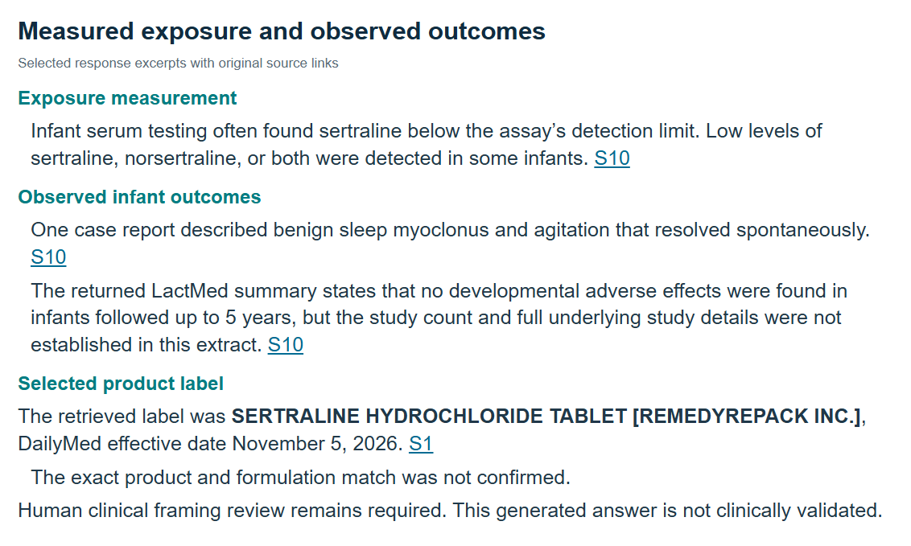
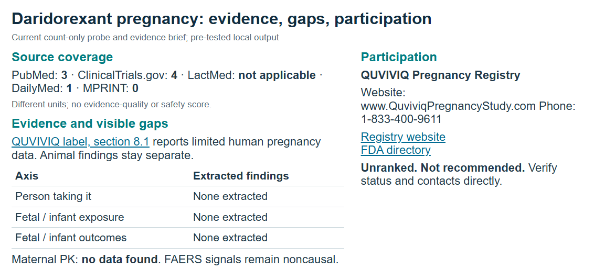
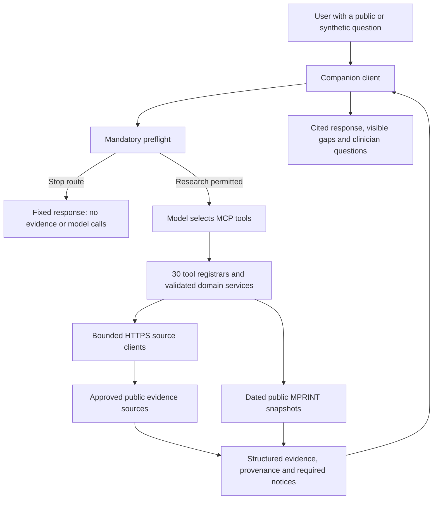

# Parent-child Pharmacology MCP

**GSA MCP & SI Agent Government Hackathon · Track: Dataset Access Server**

**THIS MCP HAS BEEN MADE FOR THE PURPOSE OF THE GSA HACKATHON AS A PROTOTYPE AND IS NOT AN NIH OFFICIAL MCP TOOL. NO PRODUCTION READINESS CLAIM.**

Public medication evidence is spread across labels, lactation records, publications, trial registries and research datasets. A parent preparing for a clinician visit, a researcher looking for evidence gaps, and a program officer reviewing a research portfolio need different views of that evidence—and need to see what is missing.

This MCP server gives AI clients structured, cited access to those sources through **30 tools, four prompts and four resources**. Its evidence brief separates effects on the pregnant or lactating person, measured fetal or infant exposure, and observed fetal or infant outcomes. Empty rows stay visible. **Missing data never means safe.**

The bundled companion supports user-guided evidence discovery and clinician preparation. Preflight checks stop unsupported requests before research; permitted requests produce evidence, limitations and questions to discuss with a clinician. It is not an independent clinical decision-maker.

**Start here:** [Demo video](#demo-video) · [Screenshots](#screenshots) · [For judges](#for-judges) · [Results](#results-at-a-glance) · [Run locally](#run-it-yourself)

| Submission material | Open it |
|---|---|
| Presentation | [PowerPoint: 15 main slides and 34 appendix slides](presentation/Parent-child%20Pharmacology%20MCP%20%E2%80%94%20Updated.pptx) |
| Evaluation | [GSA evaluation DOCX](documentation/Parent-child%20Pharmacology%20MCP%20-%20Evaluation.docx) · [readable report](evaluation/template-alignment-revision/REPORT.md) · [rendered DOCX PDF](evaluation/template-alignment-revision/artifact-review/evaluation-rendered.pdf) |
| Demonstration | [3:10 narrated video](presentation/Parent-child%20Pharmacology%20MCP%20-%20Narrated%20demo.webm) · [captions](presentation/current-demo/narration.vtt) · [current speaking script](presentation/VIDEO_SCRIPT_CURRENT.md) |
| Evidence | [Raw metrics](evaluation/template-alignment-revision/summary.json) · [all grading flags](evaluation/template-alignment-revision/TECHNICAL_REVIEW.md) · [test and trace records](evaluation/template-alignment-revision/) |
| Implementation | [Quickstart](QUICKSTART.md) · [architecture](documentation/ARCHITECTURE.md) · [security](SECURITY.md) · [template alignment](documentation/GSA_REQUIREMENTS_REVIEW.md) |

**Version and access:** current source is **0.11.0**, policy **2026-11-21.11**. This repository is private; GitHub access is required for these materials. The existing Databricks App remains on **.9** and is not a live demo of .11. Workspace access is required for Databricks links below. Publishing this source did not deploy the App, change permissions, make the repository public, or submit the entry to GSA.

## For judges

| Criterion | Where to look | What to assess |
|---|---|---|
| Mission alignment | [Users and mission](#users-and-mission) · [architecture](documentation/ARCHITECTURE.md) | Evidence discovery for parents, clinicians, researchers and NICHD program staff; visible population and evidence gaps |
| Technical quality: maintainability | [Package](src/parent_child_pharmacology/) · [tool registrars](src/parent_child_pharmacology/tools/) | Separate schemas, source clients and domain services; thin entry point; one registrar per tool |
| Technical quality: performance and reliability | [Evaluation report](evaluation/template-alignment-revision/REPORT.md) · [local tests](evaluation/template-alignment-revision/unit-tests.xml) · [Databricks test receipt](evaluation/template-alignment-revision/databricks-job-attempt3-output.json) | Inputs, attempts, error handling, fresh captures and measured results; operational timings are observations, not a speed claim |
| Technical quality: MCP design | [Tool catalog](src/parent_child_pharmacology/tools/__init__.py) · [models](src/parent_child_pharmacology/models/) · [Inspector results](evaluation/template-alignment-revision/inspector/summary.json) | Bounded inputs, goal-oriented tools, structured provenance and explicit absence-of-evidence contracts |
| Innovation | [Workflow](#how-it-works) · [evidence-axis tests](tests/test_evidence_axes.py) | Separate maternal effects, transfer/exposure and infant outcomes, with clinician questions and a distinct participation tier |
| Presentation | [Video](#demo-video) · [screenshots](#screenshots) · [deck](presentation/Parent-child%20Pharmacology%20MCP%20%E2%80%94%20Updated.pptx) | Successful answer, identity stop, crisis route, empty result and clinician handoff; historical demos distinguished from fresh evaluation |

## Users and mission

The intended mission contribution is to support pregnancy, lactation, child-health and pediatric-pharmacology evidence discovery relevant to NICHD. This does not establish NIH sponsorship or endorsement.

| User | Example use | Boundary |
|---|---|---|
| Parents and caregivers | Prepare clinician questions using an exact medication name and linked evidence | No personal treatment, dose or medication-change recommendation |
| Clinicians | Inspect the label, lactation record and literature behind a generated summary | Discovery aid; no substitute for clinical judgment or comprehensive review |
| Researchers | Find studies, missing abstracts, thin coverage and separate participation information | Source counts are not evidence-quality scores |
| NICHD program staff | Search funded research by institute, fiscal year and topic; inspect portfolio coverage | Public RePORTER evidence for oversight, not a complete internal grants record |

## Demo video

[**Watch or download the narrated demonstration (3:10, WebM)**](presentation/Parent-child%20Pharmacology%20MCP%20-%20Narrated%20demo.webm)

[](presentation/Parent-child%20Pharmacology%20MCP%20-%20Narrated%20demo.webm)

**Historical demonstration:** this video replays selected saved local **.4** outputs with computer-generated narration. It is not live chat, a recording of the deployed App, or a fresh .11 evaluation. On-screen or spoken references to “current” describe the recording's version. Latest results are [below](#results-at-a-glance); the [updated speaking script](presentation/VIDEO_SCRIPT_CURRENT.md) supplies current metrics. Download the WebM if GitHub does not offer playback.

| Time | Demonstration | What it makes visible |
|---|---|---|
| 0:00 | Cross-source evidence | Exposure measurements and observed outcomes remain separate; original links are retained |
| 0:23 | “My little white pill” | Unconfirmed identity stops before downstream retrieval or model answering |
| 0:37 | Crisis cue | Fixed support response; no medication research or participation suggestions |
| 0:54 | Thin pregnancy evidence | Empty rows, missing maternal pharmacokinetics and separate participation |
| 1:25 | Empty result | No evidence retrieved does not mean evidence of safety |
| 1:40 | Clinician questions | A concrete preparation and handoff output |
| 1:59 | Safety risks | Failure modes with clinical consequences and their controls |
| 2:27 | Limits | Heuristic routing, incomplete evidence and need for clinical review |

[Captions](presentation/current-demo/narration.vtt) · [timing manifest](presentation/current-demo/video-manifest.json) · [saved demo provenance](presentation/current-demo/NARRATION.md)

## Screenshots

These are **rendered excerpts of saved .4 outputs**, not screenshots of a newly deployed .11 application. [Demo cards](presentation/current-demo/cards.json) retain the content and source references. Counts and source status shown here are historical snapshots.

| Identity confirmation | Evidence, gaps and participation |
|---|---|
|  |  |
| The vague-identity request stops before research. | Empty rows remain visible; participation is separate and unranked. |

| Empty evidence | Clinician preparation |
|---|---|
|  |  |
| Absence of retrieved evidence is explicitly disclosed. | The output helps the user prepare a conversation. |

## How it works



1. **Confirm the question and medication identity.** The bundled client applies preflight before downstream research. Urgent/crisis, unconfirmed-identity and unsupported-language routes stop conservatively.
2. **Retrieve bounded evidence.** Tools normalize ingredients, query public sources and return structured results. The composite brief covers confirmed ingredients and preserves population/age-band tags.
3. **Keep three evidence axes visible.** Effects on the pregnant/lactating person, measured fetal/infant transfer or exposure, and observed fetal/infant outcomes stay separate—even when a row is empty.
4. **Carry limitations with the data.** Missing abstracts/sections, truncation, source dates, label-selection basis, dose-bearing passages and noncausal adverse-event counts travel in the payload.
5. **Support preparation.** Responses link to sources and offer clinician questions. Registries, recruiting studies and public-input notices form a separate, unranked participation tier, suppressed on stop routes.

The model is supplied by the client; an MCP server is not itself a model or chatbot UI. The bundled companion uses a Databricks model gateway. Other clients must implement the same preflight and required-display contracts; MCP registration alone does not enforce those client behaviors. [Architecture details](documentation/ARCHITECTURE.md).

## Data sources and tool coverage

| Source or capability | Purpose | Important limit |
|---|---|---|
| RxNorm | Normalize names and ingredients | A name match does not confirm the user's exact product |
| LactMed | Lactation records, exposure measurements and infant findings | **Lactation-only**, not a pregnancy database; semantic search currently returns `not_enabled` |
| DailyMed and FDA sources | Selected labeling, pediatric changes, recalls, alerts and adverse-event reports | Label selection/version matter; FAERS counts lack denominators and do not establish causation |
| PubMed | Pregnancy/lactation literature and available abstracts | Search coverage is bounded; missing abstracts are disclosed |
| ClinicalTrials.gov and FDA registry directory | Studies and pregnancy exposure registries | Verify status and contacts; inclusion is not a recommendation |
| NIH RePORTER | Funded research and program-staff portfolio exploration | Public records have coverage and reporting limits |
| Public MPRINT snapshots; NICHD/BPCA material | Domain-specific records, outcomes, classifications and research links | Dated snapshots are not a live or complete evidence base |
| MedlinePlus | Patient education, including source-authored Spanish material | Spanish education does not imply supported Spanish clinical chat |
| Federal Register | Public-input opportunities in the participation tier | Ancillary capability; never a treatment or participation recommendation |

Browse the [30-tool catalog](src/parent_child_pharmacology/tools/__init__.py), [source clients](src/parent_child_pharmacology/clients/), [four prompts](src/parent_child_pharmacology/prompts/) and [four resources](src/parent_child_pharmacology/resources/). The main workflow tool is `medication_evidence_brief`; targeted tools include `normalize_drug`, `check_evidence_coverage`, `search_funded_research` and `find_pregnancy_exposure_registries`.

## Results at a glance

**Latest evaluated version: .11.** These results describe the retained fresh run, not the historical demo. Counts measure different things and should not be added together.

| Measure | Verified result | What it does not establish |
|---|---|---|
| Application tests | **622/622 locally; 622/622 in Databricks**, no failures or skips | Clinical correctness, broad robustness or production readiness |
| Grader checks | **30/30 unit tests; 10/10 synthetic controls** on both dimensions | Independent clinical review |
| MCP Inspector | **9/9 checks**, 30 tools, four prompts, four resources | Every possible input or client behavior |
| Fresh chat routing and tool selection | **28/28 expected routes; 28/28 tool checks** | Detection of every unsafe or ambiguous question |
| Fixed stops | **7/7**, zero downstream evidence/model calls | General safety or triage performance |
| Research answers | **17/21 fidelity passes; 21/21 tasks fulfilled** | Four fidelity flags remain; task completion is not correctness |
| Paired task fulfillment | **MCP 7/7; plain model 0/7** | General superiority; seven known questions and unequal workflow capabilities |
| Paired fidelity, pass / fail / N/A | **MCP 6 / 1 / 0; plain 1 / 4 / 2** | N/A is not a pass and is excluded from fidelity rates |
| Citation and trace checks | **21/21 URL-membership checks; 42 unique MLflow rows verified** | That a link supports a claim or a score is medically valid |

[Full report](evaluation/template-alignment-revision/REPORT.md) · [raw metrics](evaluation/template-alignment-revision/summary.json) · [Windows/Linux CI for the evaluated implementation](https://github.com/gpiat333/Parent-Child-Pharmacology-MCP/actions/runs/44981280973) · [MLflow run](https://dbc-aae0ba16-8727.cloud.databricks.com/ml/experiments/1096079759942705/runs/c7692274f7784cfc8ec42460bf690dc5) · [Databricks notebook tests](https://dbc-aae0ba16-8727.cloud.databricks.com/?o=7474654188777746#job/822020545690582/run/681391949470158)

### What the grades mean

**Fidelity** asks whether claims are supported by the captured, bounded reference pool. **Task fulfillment** asks whether requested requirements were met. They are separate, fallible model judgments. URL membership and quote checks do not establish medical truth, relevance or safety.

The four retained research flags concern an absence-of-literature statement overstated as absence of measurement (R02), extra caveats outside the reference pool (R12), ancillary wording about an unvalidated MCP-generated review (E01), and a lactation-only heading on mixed pregnancy/lactation research (S6-pregnancy). Paired E01 separately flags an unestablished FDA-approved label status. Flags vary in consequence; all raw rationales remain in the [technical review](evaluation/template-alignment-revision/TECHNICAL_REVIEW.md).

These are **known development questions, single retained trials and same-family model grading**. There was no clinician adjudication or manual score override. The shared reference pool may contain evidence an answer did not receive. MCP alone has retrieval, preflight and required notices; the main companion also has a source-review pass absent from the paired runner. Live sources and model variability affect results. No clinical-accuracy, speed or general-superiority claim follows.

Previous .10 results—592 tests, research 21/21 fidelity and 21/21 tasks, paired tasks MCP 5/7 and plain 0/7—remain [historical evidence](evaluation/abstract-disclosure-revision/). Differences between fresh runs are not a causal estimate.

## Safety and security

The intended use is **evidence discovery and clinician preparation**. This is not prescribing or personal treatment guidance, clinical triage, exhaustive evidence or a guarantee of safety, or clinical certification.

| Failure mode | Implemented control and remaining boundary |
|---|---|
| Partial retrieval looks complete | Missing sections, truncation, label-selection basis and ingredient coverage are disclosed; extraction can still miss context |
| Missing data sounds reassuring | Explicit no-evidence fields and study-base uncertainty; “no reports” is not a safety conclusion |
| Population mismatch | Population tags and separate neonate/infant/child/adolescent bands; generated wording still needs review |
| Counts read as rates | FAERS denominator and causation caveats remain in the payload |
| Superseded information looks current | Legacy letter-category flags, label dates and snapshot revision metadata; freshness remains source-dependent |
| Adverse findings prompt medication discontinuation | Context and standing medication-change notices; accurate wording can still be alarming and needs independent clinical review |

Network controls include an exact HTTPS host/port allowlist, rejected redirects, disabled proxy inheritance, bounded timeouts/retries and a 5 MB response cap. Credentials are attached only to explicitly configured remote MCP destinations; no Databricks token is sent to loopback. Logging is filtered and HTTP access logs are disabled. See [outbound-security tests](tests/test_outbound_security.py), [credential tests](tests/test_client_credentials.py) and [the security model](SECURITY.md).

Use **public or synthetic questions only**. Local HTTP has no built-in authentication and must remain loopback. Future hosting requires authenticated access, egress and retention policies. Routing is heuristic; no penetration-test, clinical-certification or production-readiness claim is made. No real credentials were detected in the reviewed staged scan; two unchanged non-secret OAuth identifiers are documented in [the scan review](evaluation/template-alignment-revision/security-scan-review.json).

## Run it yourself

Prerequisites: **Python 3.13 and [uv](https://docs.astral.sh/uv/)**. Clone this private repository with an authorized GitHub account, then run from its root:

```sh
uv sync --locked --group dev
uv run --locked python main.py
```

Default transport is **stdio**, for an MCP client to launch as a subprocess—not a browser interface. Public-source retrieval does not require Databricks or a model account. Configure your NCBI contact email for live NCBI use. [QUICKSTART.md](QUICKSTART.md) covers client configuration, `.env.example`, optional loopback HTTP, `/health` and `/version`.

Run application and grader checks:

```sh
uv run --locked pytest tests -q
uv run --locked pytest eval/harness/tests -q -o pythonpath=eval/harness
uv run --locked ruff check src tests main.py eval/run.py eval/databricks/submit-tests.py
uv run --locked ruff format --check src tests main.py eval/run.py eval/databricks/submit-tests.py
uv build
```

Fresh chat/model comparisons need separately configured Databricks model access and can incur costs. Follow the [evaluation harness](eval/README.md) and use a **new output directory**. The [Databricks test kit](eval/databricks/README.md) runs isolated notebook tests without changing the App. Frozen source hashes, failed attempts and raw grades are preserved.

## Repository map and template alignment

| Path | Role |
|---|---|
| `main.py`, `pyproject.toml`, `uv.lock`, `.env.example` | Root entry point, package, locked dependencies and configuration |
| `src/parent_child_pharmacology/` | Application, schemas, source clients, shared controls and domain services |
| `src/parent_child_pharmacology/tools/` | One registrar per tool; separate `prompts/` and `resources/` |
| `chat-client/` | Companion orchestration, preflight and required-display behavior |
| `tests/` | Application, security and client-contract regression tests |
| `eval/` | Current portable evaluation harness and Databricks test kit |
| `evaluation/` | Dated captures, metrics, raw judgments, test and MLflow receipts |
| `presentation/` | Deck, historical narrated demo, screenshots and current speaking script |
| `documentation/` | Evaluation DOCX, architecture, methodology, requirements and deployment guidance |
| `deploy/databricks/`, `Dockerfile`, `server.json` | Future deployment kit, container build and registry metadata; no automatic deployment |
| `.github/workflows/ci.yml` | Windows/Linux lint, format, application/grader tests and package builds |
| `SECURITY.md`, `NOTICE.md`, `LICENSE-GSA-TEMPLATE` | Security boundaries and template attribution |

The [GSA template](https://github.com/GSA-TTS/mcp-hackathon-template) supplies the engineering scaffold. This repository aligns its existing implementation in place; it does **not** claim a recreated template ancestry. This README adds a project-specific submission guide. [The requirements review](documentation/GSA_REQUIREMENTS_REVIEW.md) maps implementation to the template and official evaluation materials.

## Scope and next steps

The prototype surfaces evidence gaps; it does not close them. Priorities before considering real-world use are independent clinical framing review, held-out and repeated evaluations, broader adversarial/language testing, source-coverage review and deployment security/operating review. The existing Databricks App remains on .9; publishing .11 source and running Databricks tests did not redeploy it.

Built for the GSA hackathon as a prototype. **Not an official NIH MCP tool. No production readiness claim.**
