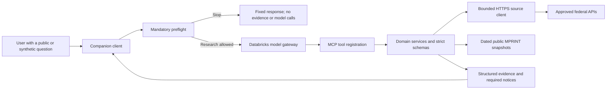

# Current architecture

The Python 3.13 package is rooted at `src/parent_child_pharmacology`. Root `main.py` delegates to `app.py`. Default stdio is launched by a local MCP client; optional streamable HTTP binds to loopback. Health and version routes do not depend on live sources. Hosted Databricks App OAuth is a platform boundary, not application-owned authentication.

Thirty small tool registrar modules expose domain services. Four prompts and five resources have separate registration modules. Clients implement upstream retrieval; shared core handles configuration, HTTP policy, preflight, output notices, and audit metadata. `mc` compatibility facades retain existing import surfaces and snapshot access. Root `tests/` contains the application and client-contract regressions.

The evidence brief keeps maternal effects, measured fetal/infant transfer or exposure, and observed fetal/infant outcomes separate, retaining empty rows. Participation remains separate and unranked, suppressed on stops. LactMed is lactation-only. Missing abstracts, expected-but-missing sections, truncation, population tags, dose-bearing passages and source dates are machine-readable. These are discovery and display contracts, not clinical inference or certification.

`eval/` contains the current portable harness. `evaluation/` holds immutable dated captures, diagnostic grades and run receipts. The paired runner compares the same model with and without MCP tools, with explicit workflow differences. Databricks testing does not imply a new App deployment. See `SECURITY.md` and the current evaluation report for runtime boundaries and verified results.

Remote HTTP now requires application-verified RS256 tokens and individual tool scopes in addition to platform access controls. See SECURITY.md and .env.example. Default stdio and optional loopback HTTP remain suitable for local public-data development. No new App deployment is included.
