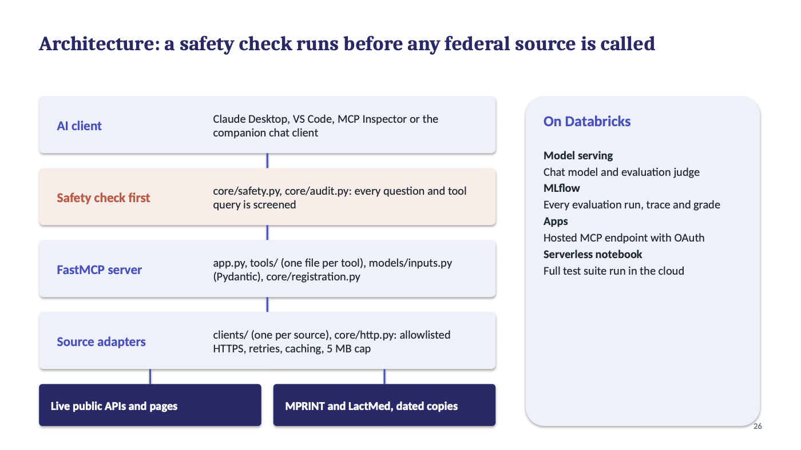

# Parent-child Pharmacology MCP: deck

[◀ Previous](slide-25.md) · **Slide 26 of 42** · [Next ▶](slide-27.md)

[◀ Previous](slide-25.md) · **Slide 26 of 42** · [Next ▶](slide-27.md)

Click the slide to go to the next one. [First slide](slide-01.md) · [Back to the README](../../README.md) · [Demo video](../Parent-child%20Pharmacology%20MCP%20-%20Demo%20video.mp4)
